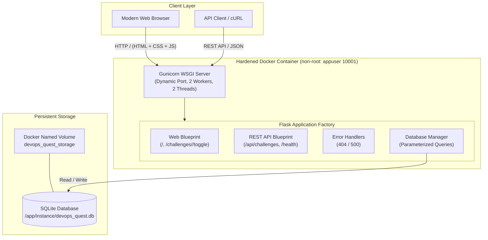
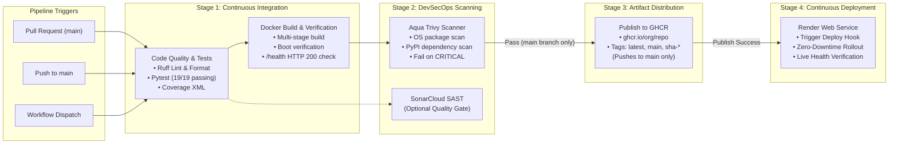

# 🏗️ DevOps Quest - System & Pipeline Architecture

This document details the architectural design, component layers, data persistence model, and automated CI/CD & DevSecOps pipeline workflows for **DevOps Quest**.

---

## 1. High-Level System Architecture

DevOps Quest is designed as a decoupled, multi-layered modern web application adhering to the twelve-factor methodology:

---

## 2. CI/CD & DevSecOps Pipeline Architecture

The automated GitHub Actions workflow (`.github/workflows/ci.yml`) enforces rigorous quality, security, containerization, and continuous delivery gates:

---

## 3. Component Deep Dive

### Presentation Layer
- **HTML5 & Jinja2 Templates**: Semantic layout (`base.html`), accessible form elements, dynamic progress tracking, and custom 404/500 error pages.
- **Modern Dark-Themed CSS**: Custom CSS properties (`--bg-primary`, `--accent-green`, etc.), responsive flexbox and grid layouts, WCAG AA compliant contrast ratios.
- **Vanilla JavaScript**: Asynchronous `fetch` calls to toggle completion status without page reloading, instant recalculation of metrics and progress bars, client-side filtering, and automated `/health` polling.

### Application & Routing Layer
- **Flask Application Factory (`create_app`)**: Decouples configuration from application instantiation, enabling isolated in-memory or temporary database fixtures during tests.
- **Blueprints**:
  - `web_bp`: Serves server-rendered HTML views and standard POST form fallback actions.
  - `api_bp`: Exposes clean JSON endpoints for programmatic consumption and automation.
- **Safety Defaults**: Debug mode strictly disabled by default (`FLASK_DEBUG=0`), preventing interactive traceback debuggers from ever running in production.

### Data Access & Persistence Layer
- **SQLite Relational Engine**: Embedded, lightweight, zero-configuration persistence.
- **Parameterized SQL**: All dynamic inputs use parameterized queries (`?`), preventing SQL injection attacks.
- **Container Volume Persistence**: Mounted at `/app/instance`, ensuring SQLite files survive container re-deployments and host restarts.

### DevSecOps & Security Hardening
- **Non-Root Execution**: Container runs under dedicated unprivileged UID `10001` (`appuser`).
- **Minimal Attack Surface**: Multi-stage Dockerfile discards build tools, compiling utilities, and pip caches in the final image (`python:3.13-slim-bookworm`).
- **Aqua Trivy Policy**: Audits container layers and Python dependencies; fails build on unmitigated `CRITICAL` severity CVEs.
- **Secret Hygiene**: Zero secrets stored in source control; pipeline uses `GITHUB_TOKEN` for GHCR and encrypted repository secrets for Render.

